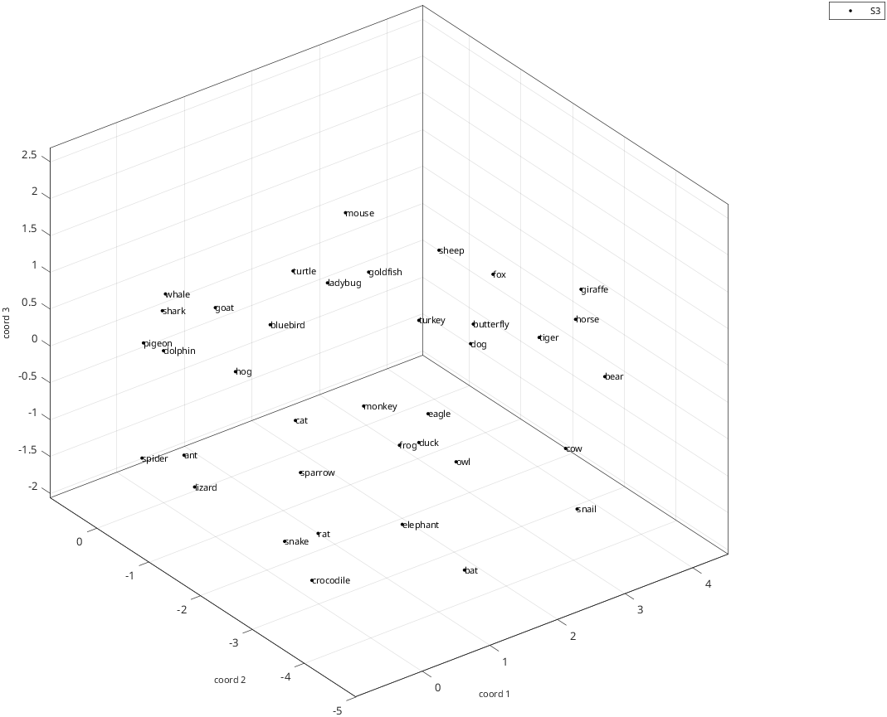
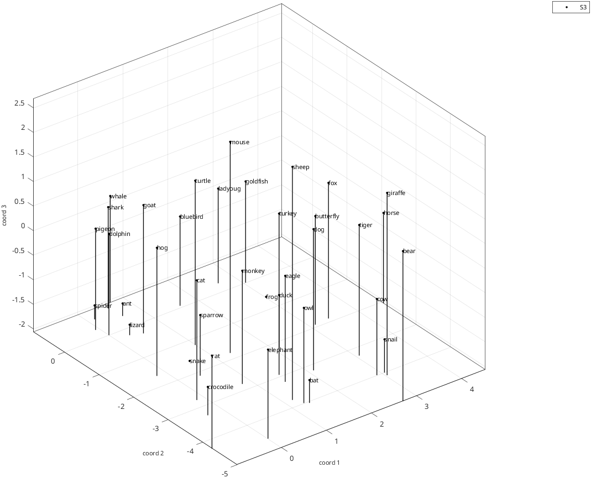
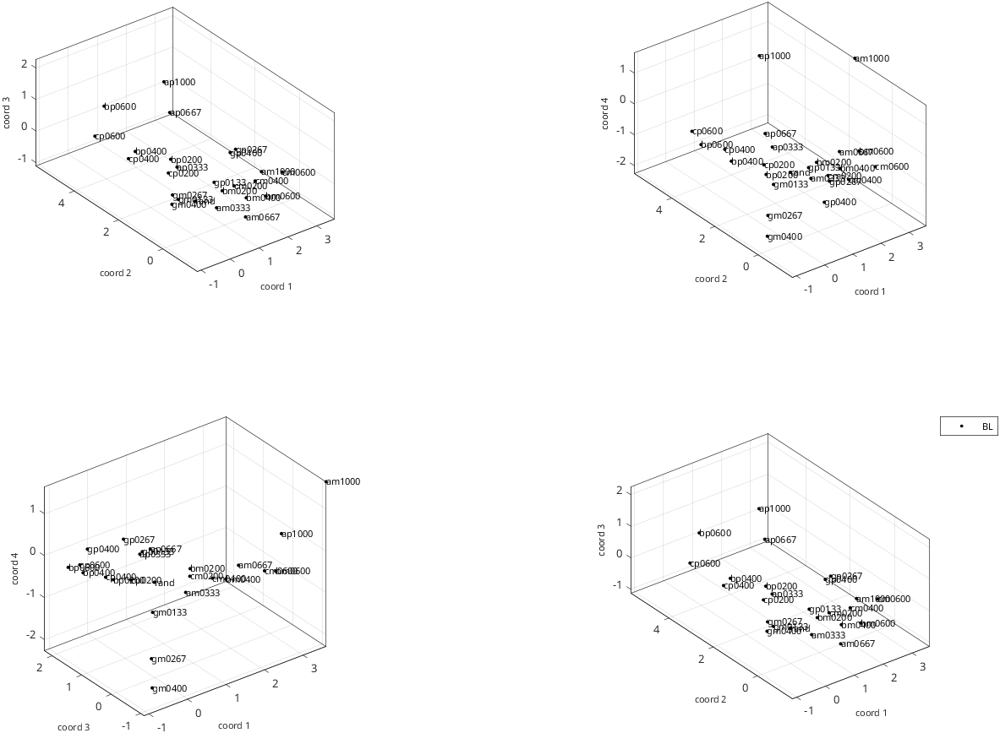
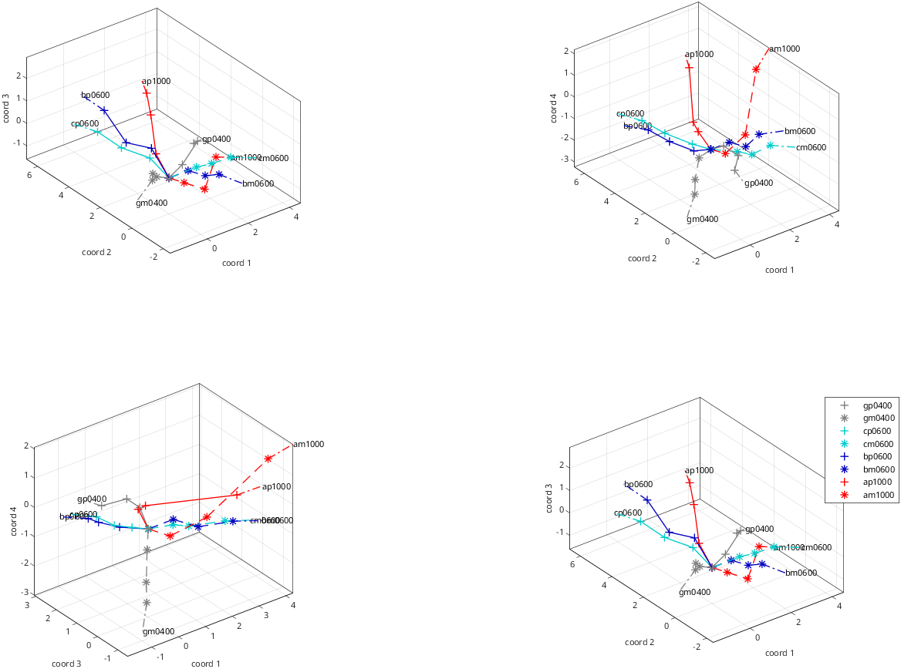
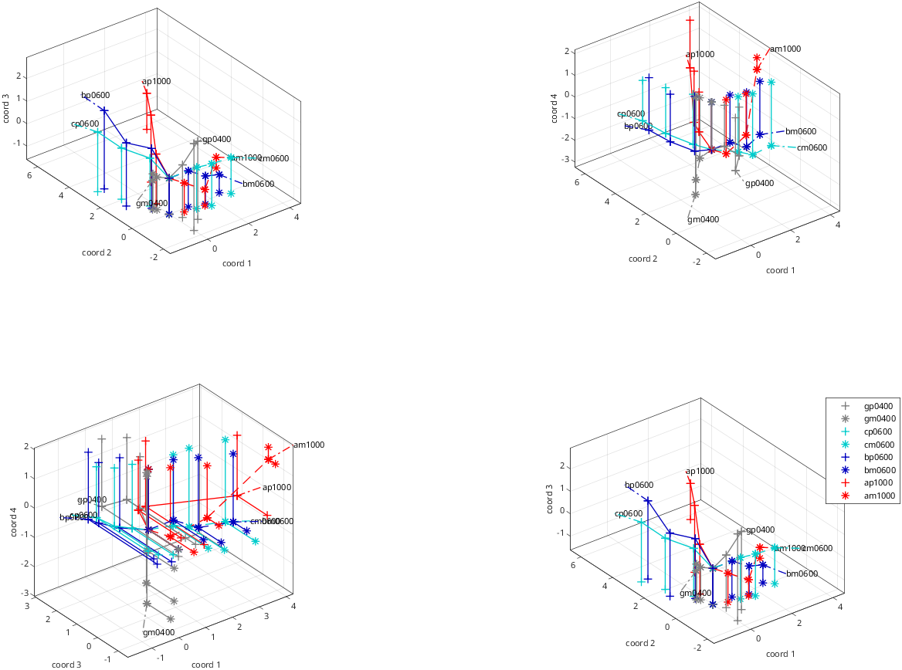
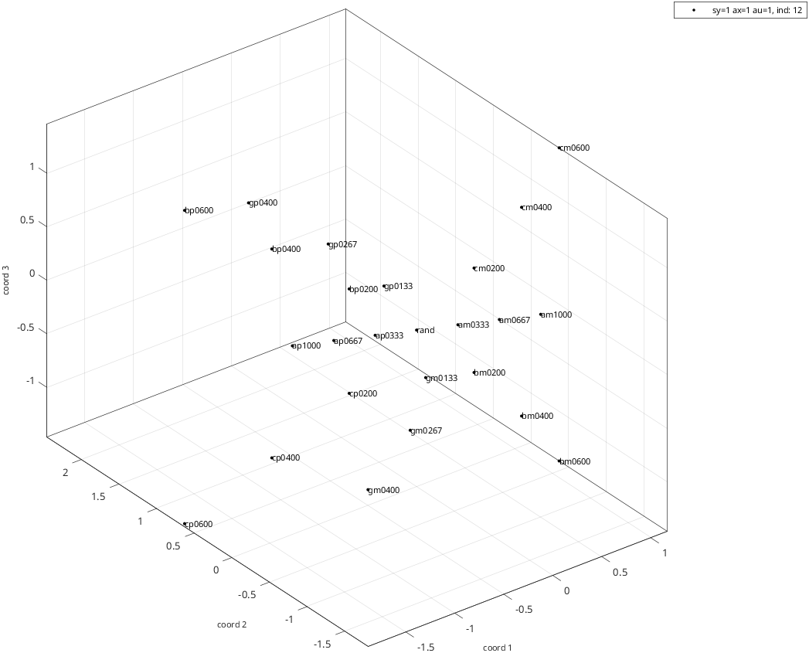
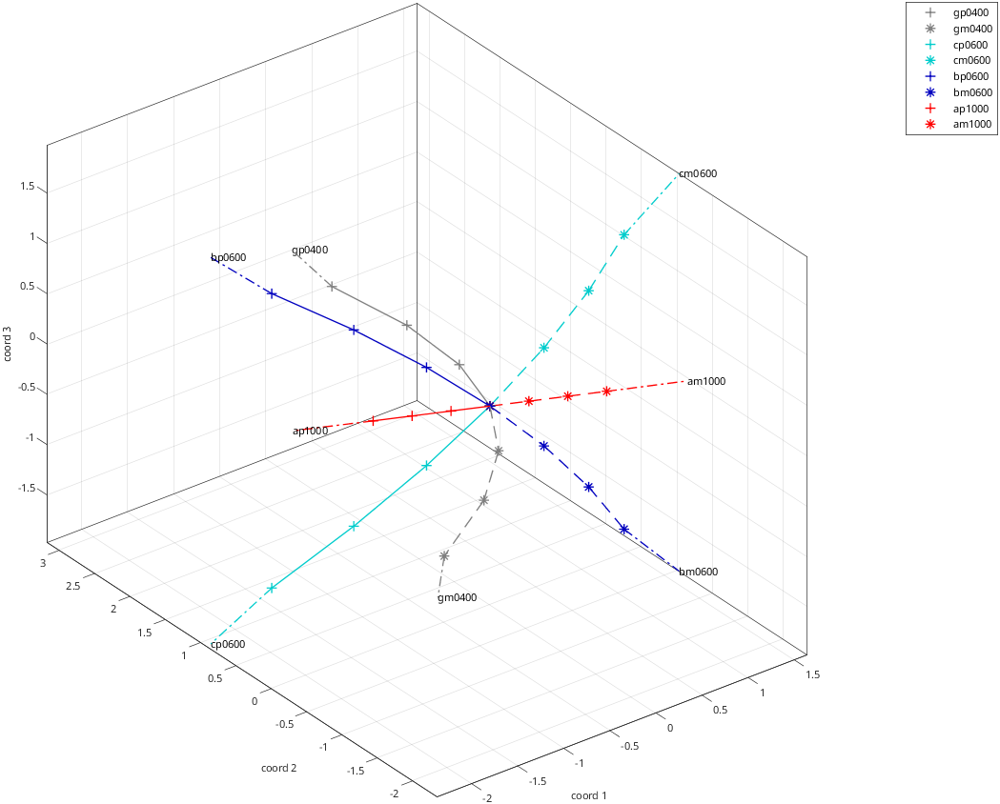
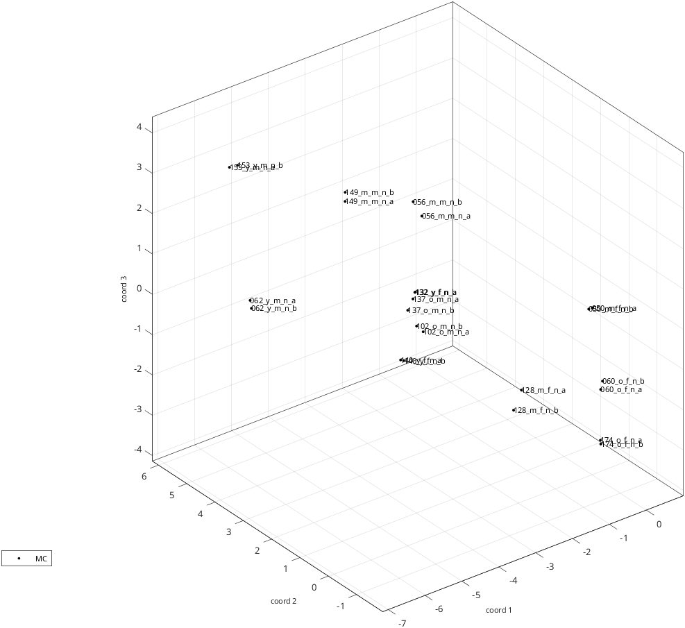
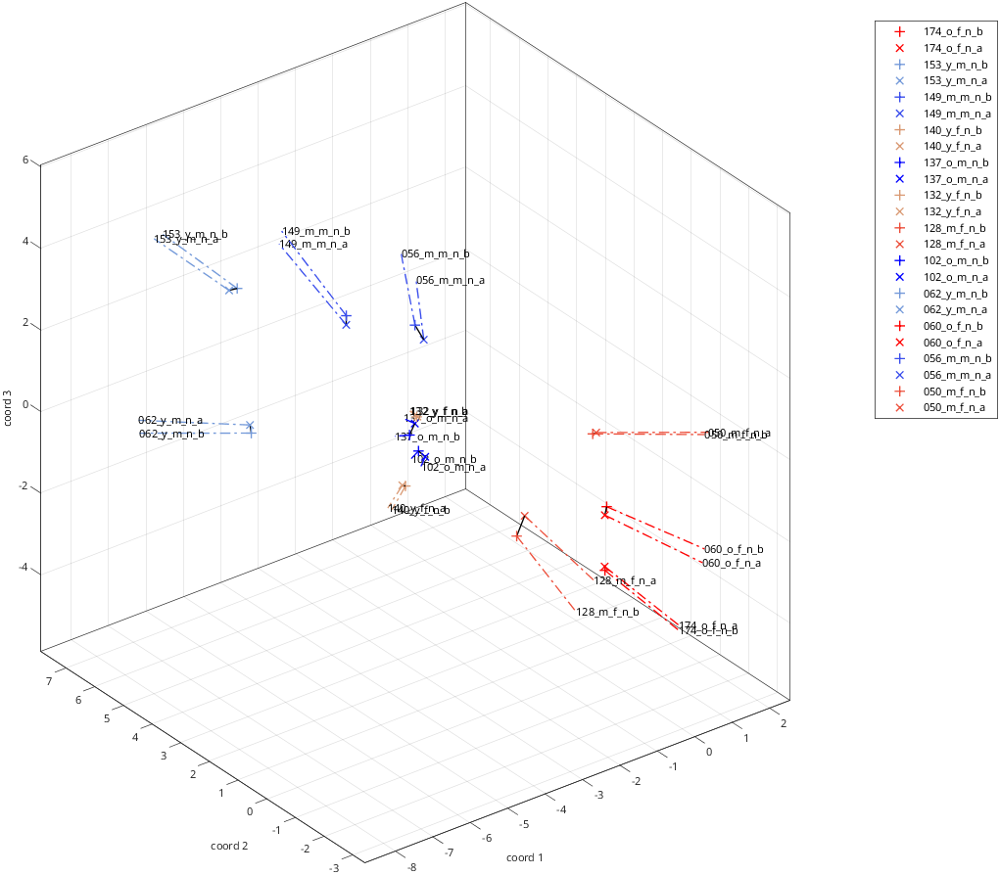
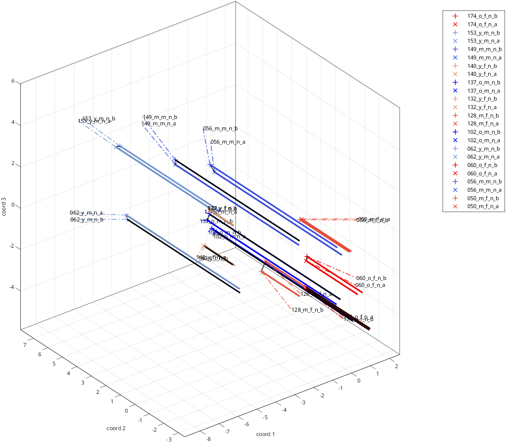

# rs_disp_coordsets_demo
Display coordinate sets, one option at a time, in four kinds of data

This demo reads four datasets and plots each of them, adding one display option
at a time so that you can see what each option changes. Every step below shows
the code, what it prints, and the figure it draws.

1. Animal images: the default plot, then dropped perpendiculars.
2. Binary textures: a 4-dimensional model and rays, which need `stimulus coordinates`.
3. Binary textures again: the same stimuli, from a `quadratic form model`.
4. Faces: stimulus names that need a custom interpreter, and rays with a single point.

See also:  [rs_get_coordsets](rs_get_coordsets.md), [rs_disp_coordsets](rs_disp_coordsets.md), [rs_disp_enh_coordsets](rs_disp_enh_coordsets.md)

## Setup
The defaults of the toolbox can be customized in each installation. To get the
same plots everywhere, this demo uses the defaults stored in a fixed file,
through `rs_aux_force`, so you can skip this block when you use the toolbox
in your own analyses.

```matlab
if ~exist('aux_force_filename') aux_force_filename='rs_aux_defaults_btc.mat'; end
auxs_force=struct;
opts_needed={'opts_read','opts_rays','opts_qpred','opts_disp'};
for k=1:length(opts_needed)
    auxs_force.(opts_needed{k})=rs_aux_force(opts_needed{k},[],aux_force_filename);
end
```

All four examples read their file with these options, so we set them only once.

```matlab
aux_in=auxs_force;
aux_in.opts_read.input_type=1; %the file holds experimental data
aux_in.opts_read.if_auto=1;    %read without asking questions at the console
aux_in.opts_read.if_log=1;     %print a log of what is read
aux_in.nsets=1;                %one dataset per call
```

## Example 1: animal images
The animal domain has 37 stimuli and no `stimulus coordinates`. This dataset is
from one subject of Waraich and Victor, J. Neurosci. 2024. See
[Domains](../../domains.md) for a description.

`rs_get_coordsets` returns a `dataset structure`, holding one model per dimension.

```matlab
[data_animals,aux_animals]=rs_get_coordsets('./samples/animals/image_coords_S3',aux_in);
```

Output:

```text
 
 entering set  1 of  1:
primary dataset 1 is experimental data
 37 different stimulus types found in  data file ./samples/animals/image_coords_S3
 37 different stimulus types found in setup file [unused]
 37 of  37 labels found
coordinate sets with  1 to  7 dimensions read.
 
datasets selected:
 set  1: dim range [  1   7] label: samples/animals/image_S3
##### rs_warning: cannot find stimulus coordinates, so cannot identify rays
```

The warning is expected: without stimulus coordinates there are no rays to find.
ordsets
The `set metadata structure` describes the dataset. We will use the subject ID
as the label of the plots.

```matlab
disp(data_animals.sets{1});
```

Output:

```text
             type: 'data'
    paradigm_type: 'animals'
    paradigm_name: 'image'
          subj_id: 'S3'
    subj_id_short: 'S3'
            extra: []
         dim_list: [1 2 3 4 5 6 7]
           nstims: 37
       label_long: './samples/animals/image_coords_S3'
            label: 'samples/animals/image_S3'
         pipeline: [1x1 struct]
```

### The default plot
With no other options, `rs_disp_coordsets` shows the 3-dimensional model and
labels each point with its stimulus name.

```matlab
opts_disp=struct;
opts_disp.set_labels=data_animals.sets{1}.subj_id; %label the dataset by subject ID
rs_disp_coordsets(data_animals,struct('opts_disp',opts_disp));
```



### Dropped perpendiculars
A 3-dimensional plot on a flat page makes depth hard to judge. Dropping a
perpendicular from each point makes its position easier to read.
`perp_data_dims` has one entry per coordinate, and here 1 selects coordinate 3.
We also omit the marker at the foot of each line.

```matlab
opts_disp.perp_data_dims=[0 0 1];
opts_disp.perp_data_usemarkers=0;
rs_disp_coordsets(data_animals,struct('opts_disp',opts_disp));
```



## Example 2: binary textures
This domain has `stimulus coordinates`. A stimulus name gives its coordinate
and value: `gp0400` means coordinate g at +0.4, `gm0400` means coordinate g
at -0.4, and `rand` is the origin. The data are from Victor and Conte, VSS 2025.

This time there is no warning, because the setup file provides the coordinates.

```matlab
[data_textures,aux_textures]=rs_get_coordsets('./samples/bwtextures/bgca3pt_coords_BL_sess01_10',aux_in);
```

Output:

```text
 
 entering set  1 of  1:
primary dataset 1 is experimental data
 25 different stimulus types found in  data file ./samples/bwtextures/bgca3pt_coords_BL_sess01_10
suggested ray permutation for bgca:
     2     1     3     4

 25 different stimulus types found in setup file ./samples/bwtextures/bgca3pt9.mat
 25 of  25 labels found
coordinate sets with  1 to  7 dimensions read.
 
datasets selected:
 set  1: dim range [  1   7] label: samples/bwtextures/bgca3pt_BL_sess01_10
```

### Plotting more than three dimensions
A 4-dimensional model does not fit in one 3-dimensional plot, so it is shown as
several plots of 3 coordinates each. `coord_group_method='keepone'` keeps
coordinate 1 in every plot and steps through the others, giving the groups
[1 2 3], [1 2 4] and [1 3 4]. With `if_legend=-1` these plots have no legend,
and an extra subplot repeats the first group with the legend next to it.

```matlab
opts_disp=struct;
opts_disp.set_labels=data_textures.sets{1}.subj_id;
opts_disp.dim_select=4;
opts_disp.coord_group_method='keepone';
opts_disp.if_legend=-1;
rs_disp_coordsets(data_textures,struct('opts_disp',opts_disp));
```



### Rays
The labels above overlap, and nothing shows that the stimuli are organized along
axes. Reading the file also produced a `ray structure` in `aux_textures.rayss`,
which groups the stimuli that lie along the same line through the origin.
`rs_disp_enh_coordsets` draws those lines. With `if_points=0` it draws only the
rays. Each color is one coordinate, with + for its positive values and * for
its negative values.

```matlab
opts_disp_enh=struct;
opts_disp_enh.if_points=0;
aux_disp=struct('opts_disp',opts_disp,'opts_disp_enh',opts_disp_enh);
rs_disp_enh_coordsets(data_textures,aux_disp,aux_textures.rayss{1});
```



### Rays and perpendiculars
The display options of `rs_disp_coordsets` also work here. In `perp_data_dims`,
1 drops a perpendicular along that coordinate to the bottom of the plot, and -1
raises it to the top. So coordinate 3 goes down, and coordinate 4 goes up.

```matlab
opts_disp.perp_data_dims=[0 0 1 -1];
aux_disp=struct('opts_disp',opts_disp,'opts_disp_enh',opts_disp_enh);
rs_disp_enh_coordsets(data_textures,aux_disp,aux_textures.rayss{1});
```



## Example 3: binary textures from a quadratic form model
Here we read the same file name as in Example 2, but with `input_type=2` it
gives the stimuli of a `quadratic form model`, not the measured coordinates of
subject BL. Compare the log below with the one of Example 2: the dataset is now
a "qform model", with models of up to 10 dimensions, one for each coordinate of
this domain.

```matlab
aux_qform=aux_in;
aux_qform.opts_read.input_type=2;
[data_qform,aux_qform_out]=rs_get_coordsets('./samples/bwtextures/bgca3pt_coords_BL_sess01_10',aux_qform);
```

Output:

```text
 
 entering set  1 of  1:
primary dataset 1 is qform model
suggested ray permutation for bgca:
     2     1     3     4

 25 different stimulus types found in setup file ./samples/bwtextures/bgca3pt9.mat
 model 12 (sy=1 ax=1 au=1) loaded from ./samples/bwtextures/btc_allraysfixedb_avg_100surrs_madj.mat
 
datasets selected:
 set  1: dim range [  1  10] label: samples/bwtextures/bgca3pt9 c:aug q:samples/bwtextures/avg_madj m:qform
```

The paradigm type of a model is not recognized from the file, so we set it. The
enhanced display uses it to choose the colors and symbols of the stimuli.

```matlab
data_qform.sets{1}.paradigm_type='btc';
disp(data_qform.sets{1});
```

Output:

```text
             type: 'qform'
    paradigm_type: 'btc'
    paradigm_name: []
          subj_id: 'sy=1 ax=1 au=1, ind: 12'
    subj_id_short: 'sy=1 ax=1 au=1'
            extra: []
         dim_list: [1 2 3 4 5 6 7 8 9 10]
           nstims: 25
       label_long: './samples/bwtextures/bgca3pt9.mat c:aug q:./samples/bwtextures/btc_allraysfixedb_avg_100surrs_madj.mat m:qform'
            label: 'samples/bwtextures/bgca3pt9 c:aug q:samples/bwtextures/avg_madj m:qform'
         pipeline: [1x1 struct]
```

The default plot, labeled with the name of the model:

```matlab
opts_disp=struct;
opts_disp.set_labels=data_qform.sets{1}.subj_id;
rs_disp_coordsets(data_qform,struct('opts_disp',opts_disp));
```



And with rays. The rays of the model are close to straight lines through the
origin, while the rays from data in Example 2 bend.

```matlab
opts_disp_enh=struct;
opts_disp_enh.if_points=0;
aux_disp=struct('opts_disp',opts_disp,'opts_disp_enh',opts_disp_enh);
rs_disp_enh_coordsets(data_qform,aux_disp,aux_qform_out.rayss{1});
```



## Example 4: faces
These stimuli are from the MPI FACES database (Ebner, Riediger and Lindenberger,
Behavior Research Methods, 2010). A name like `132_y_f_n_b` encodes the identity
(132), age range (y), gender (f), expression (n) and database set (b).

By default a ray needs at least 3 points besides the origin, and with these
stimuli no ray has that many. `ray_minpts=1` lets a single point define a ray.

```matlab
aux_faces=aux_in;
aux_faces.opts_rays.ray_minpts=1;
[data_faces,aux_faces_out]=rs_get_coordsets('./samples/faces/faces_mpi_en2_fc_coords_MC_sess01_10',aux_faces);
```

Output:

```text
 
 entering set  1 of  1:
primary dataset 1 is experimental data
 24 different stimulus types found in  data file ./samples/faces/faces_mpi_en2_fc_coords_MC_sess01_10
 24 different stimulus types found in setup file ./samples/faces/faces_mpi_en2_fc.mat
 24 of  24 labels found
coordinate sets with  1 to  7 dimensions read.
 
datasets selected:
 set  1: dim range [  1   7] label: samples/faces/faces_mpi_en2_fc_MC_sess01_10
```

### Stimulus names with underscores
MATLAB reads an underscore in a label as the start of a subscript. Setting the
interpreters to 'none' prints the names as they are.

```matlab
opts_disp=struct;
opts_disp.set_labels=data_faces.sets{1}.subj_id;
opts_disp.data_label_interpreter='none';
opts_disp.legend_interpreter='none';
rs_disp_coordsets(data_faces,struct('opts_disp',opts_disp));
```



### Rays
Each face is now a ray of one point, so the display gives it a color and a
symbol from its name: red shades for f and blue shades for m, with + for
database set b and x for database set a.

```matlab
opts_disp_enh=struct;
opts_disp_enh.if_points=0;
aux_disp=struct('opts_disp',opts_disp,'opts_disp_enh',opts_disp_enh);
rs_disp_enh_coordsets(data_faces,aux_disp,aux_faces_out.rayss{1});
```



### Rays and perpendiculars
This time the perpendiculars run along coordinate 2, with thicker lines and
no markers at their feet.

```matlab
opts_disp.perp_data_dims=[0 1 0];
opts_disp.perp_data_usemarkers=0;
opts_disp.perp_data_linewidths=2;
aux_disp=struct('opts_disp',opts_disp,'opts_disp_enh',opts_disp_enh);
rs_disp_enh_coordsets(data_faces,aux_disp,aux_faces_out.rayss{1});
```



## Next steps
`rs_disp_coordsets_demo_opposites` compares several subjects in one plot, and
`rs_align_disp_enh_coordsets_demo` arranges several plots in one figure.